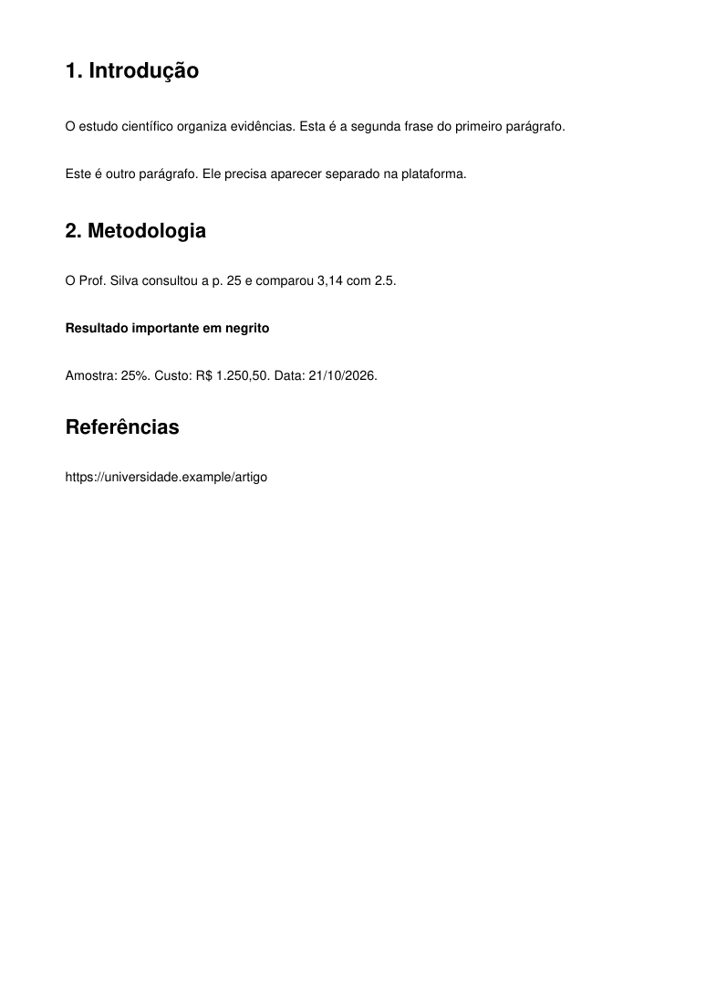
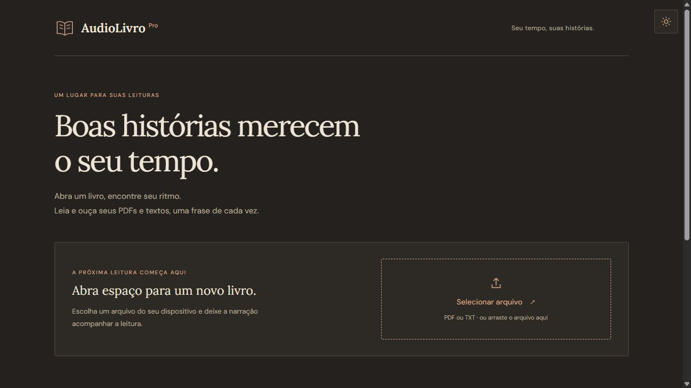
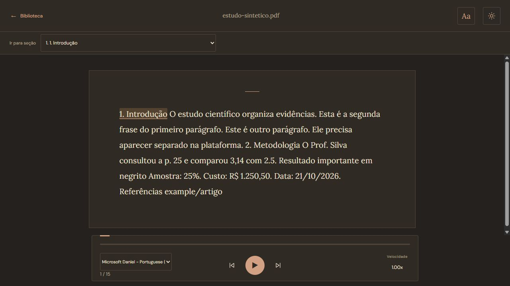
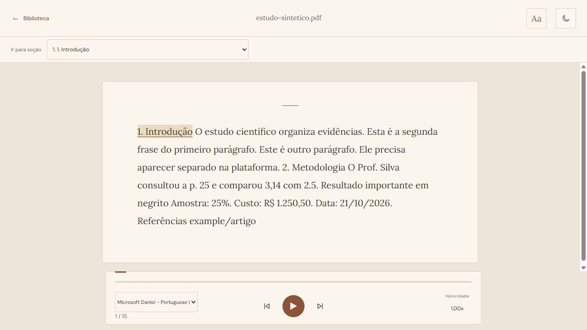
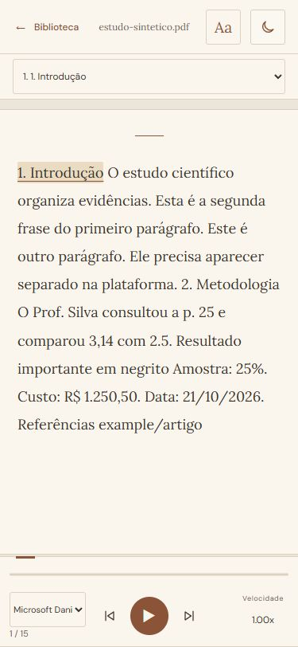
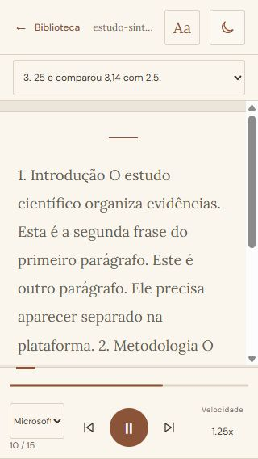
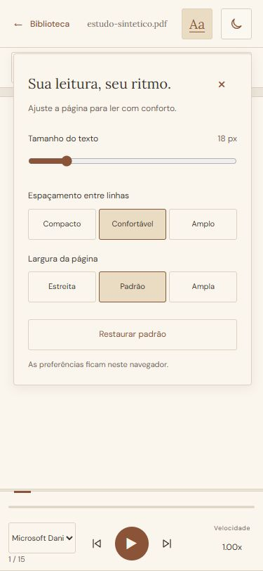
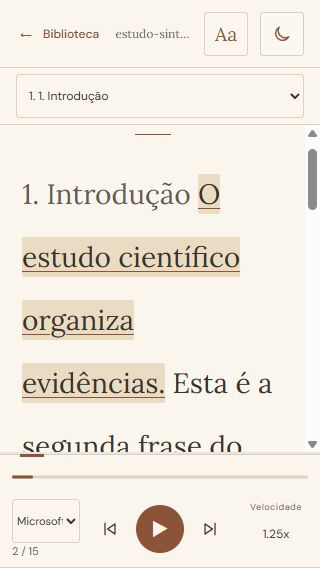
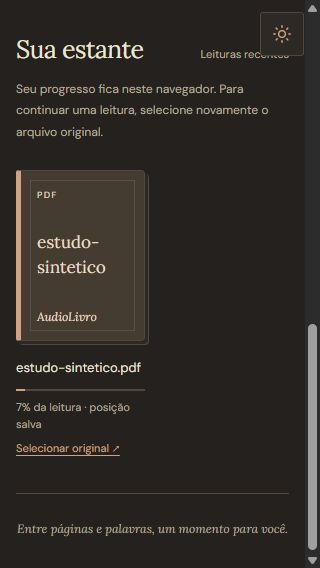

# Auditoria do AudioLivro Pro — 03/11/2026

**Veredito:** a base editorial é confortável, mas a fidelidade do material de estudo ainda tem falhas relevantes. O principal problema está no tratamento do conteúdo: títulos, parágrafos e estilos extraídos do PDF são descartados na montagem do leitor. Também reproduzi perda de números de tabela, quebra de abreviações e seções falsas. Para faculdade, corrigir isso tem mais valor que trocar a identidade visual.

Auditoria sobre `main`, commit `28e0a45870885357b09a771ec62873ccb93e6605`. A árvore de trabalho estava limpa no início. Foram adicionados somente este relatório, capturas e instrumentos de diagnóstico nesta pasta. Nenhum arquivo de produção, configuração pública, dependência ou teste existente foi alterado. Não houve commit, push ou deploy.

## Escopo, método e limites

- Inspeção do frontend, backend, testes e configuração de execução.
- Navegação na aplicação local com o backend original, usando uma configuração de API local exclusiva do servidor de auditoria.
- PDF e TXT inteiramente sintéticos; nenhum documento pessoal ou livro foi enviado ao serviço público.
- Capturas atuais em desktop 1280 × 720, celular 375 × 812 e celular 320 × 568; temas claro e escuro; fonte máxima de 28 px e espaçamento amplo.
- Execução dos 75 casos Python existentes: 66 de pipeline e 9 de API. Todos passaram. Há um aviso de depreciação do TestClient/httpx no ambiente Python 3.14, sem falha de teste.
- Sondas adicionais executam funções originais de processamento e leitura com entradas conhecidas. A sonda JavaScript usa objetos simulados e verifica lógica, não qualidade sonora.
- A narração nativa foi acionada no navegador, avançou automaticamente e chegou ao final. Não houve avaliação auditiva de pronúncia, naturalidade, inteligibilidade ou cronometragem de cada voz.
- Os arquivos Playwright `tests/library.cjs` e `tests/reader.cjs` foram inspecionados, mas a suíte deles não foi executada nesta auditoria. A navegação visual descrita abaixo foi feita pelo navegador disponível.
- Não foram validados o site publicado, a latência do Render, celular físico, tela bloqueada, leitura prolongada em segundo plano, leitor de tela, zoom de 200–400%, OCR ou um conjunto representativo de PDFs da faculdade. Não há base para prometer precisão percentual universal ou conformidade WCAG completa.

## Fluxo observado

| Etapa | Ação | Estado observado |
|---|---|---|
| 1 | Abrir a biblioteca | Importação clara, identidade consistente. Texto e espaço de apresentação excessivos para uso frequente de estudo. |
| 2 | Importar PDF sintético pela API local | Importação conclui, retorna estrutura e frases. O resultado já pode conter perdas e fragmentações. |
| 3 | Ler e comparar com o PDF original | Problema principal: títulos, parágrafos e negrito viram uma sequência de frases uniformes. |
| 4 | Navegar pelas seções | Seleção funciona, mas a detecção inclui uma frase comum como seção. |
| 5 | Reproduzir, pausar, mudar velocidade, avançar e concluir | Controles funcionam; retomada e troca de velocidade repetem a frase atual. Reproduzir após o final não reinicia. |
| 6 | Usar temas, celular e painel Aa | Sem overflow horizontal nas condições verificadas; player fora da área do texto; ajustes funcionam. Há truncamento dos nomes e problemas menores de informação. |
| 7 | Sair, abrir recente e selecionar novamente o original | Posição 2/15 e velocidade 1,25x recuperadas. O arquivo precisa ser selecionado de novo. Identificação continua baseada somente no nome. |

## Evidência visual

### 0. PDF de referência gerado nesta auditoria

O arquivo separa visualmente três títulos, parágrafos e uma linha em negrito. O texto inteiro fica dentro da página, sem cortes.



### 1. Biblioteca no desktop

Boa hierarquia e botão de arquivo evidente. A abertura ocupa quase a primeira tela com mensagens sobre histórias, antes de mostrar os recentes. Para estudo diário, a ação de continuar e os documentos recentes deveriam ter mais destaque.



### 2–4. PDF importado, texto e seções no desktop

O título aparece na mesma linha do corpo; o segundo parágrafo é colado ao primeiro; o negrito desaparece. O endereço da referência vira apenas `example/artigo`. O seletor de seções contém `25 e comparou 3,14 com 2.5.`, uma frase comum.





### 5–6. Leitor e player no celular

Em 375 px, o player não cobre o texto e a página não transborda horizontalmente. A perda da separação do conteúdo persiste. Em 320 px, o nome da voz e o nome do documento ficam abreviados. A captura de 320 px durante reprodução é um estado transitório após redimensionamento; ela não demonstra uma falha persistente de rolagem sincronizada.





O painel Aa cabe em 375 px. Em 320 px, fonte de 28 px com espaçamento amplo continua sem overflow horizontal. Frases longas podem ocupar mais de uma tela: sincronização deve preservar o começo do trecho e permitir leitura manual sem reposicionamento excessivo.





### 7. Estante e retomada

A interface informa corretamente que é preciso selecionar o arquivo original. A posição salva foi recuperada. Em 320 px, com a página rolada, o botão fixo de tema se sobrepõe à indicação “Leituras recentes”.



## Achados e correções prioritárias

Prioridades: **P1** = risco de perder informação ou prejudicar a compreensão; **P2** = funcionamento, acessibilidade ou eficiência do estudo; **P3** = acabamento e conveniência.

### F01 — P1 — A interface descarta a estrutura do PDF

**Confirmado no navegador e no código.** `loadPDF`, em `script.js:330`, entrega a `processText` apenas texto e frases. `renderText`, em `script.js:638`, cria somente spans inline. Na importação observada havia 15 spans, zero parágrafos, zero títulos HTML e zero elementos de negrito no artigo.

O backend devolve `estrutura`, com tipo, página e trechos tipográficos, mas isso não chega ao modelo de leitura. A perda ocorre na passagem entre a API e o frontend.

**Correção:** estabelecer um contrato de blocos aprovados pelo filtro, cada um com ID, tipo, página, trechos e intervalos das frases narradas. Renderizar títulos como headings e parágrafos como `p`, mantendo os spans das frases dentro deles. Separar o documento visual da fila de narração. Manter a leitura contínua e os IDs usados no destaque.

**Cuidado indispensável:** a `estrutura` atual e `texto_limpo` incluem conteúdo anterior ao filtro. Não basta renderizá-los diretamente: isso reintroduziria propaganda/resíduos removidos. O contrato novo precisa preservar a decisão do filtro e permitir explicar exclusões.

**Aceitação:** os três títulos do exemplo ficam separados do corpo, os dois primeiros parágrafos ficam distintos, o negrito aparece e todos os saltos/destaques continuam apontando à frase correta.

### F02 — P1 — Números de tabelas são apagados como paginação

**Reprodução sintética:** uma tabela com cabeçalhos `Ano / Quantidade` e valores `2024 / 125` retornou somente `Ano Quantidade` na estrutura. Em `Backend/main.py:152`, spans contendo apenas 1–4 dígitos são excluídos independentemente de estarem no corpo da página.

**Correção:** detectar paginação por posição de margem e contexto/repetição, preservando números no corpo, células, rótulos e enumerações. O valor numérico sozinho não deve ser justificativa de exclusão.

**Aceitação:** os dois valores da tabela sobrevivem e números de página verdadeiros continuam sendo removidos. Testar também anos, itens de listas, amostras e tabelas com números de uma única casa.

### F03 — P1 — Títulos próximos e parágrafos com recuo se fundem antes da interface

**Reprodução sintética:** um título de 16 pt seguido de corpo de 11 pt com pouco espaço vertical virou um único parágrafo. Dois parágrafos com diferença de recuo de 15 pt também foram unidos. A reconstrução, em `Backend/main.py:199`, considera sobretudo posição e espaçamento; não estabelece fronteira de título pela mudança tipográfica e tolera recuos que podem representar começo de parágrafo.

**Correção:** combinar blocos originais, tamanho da fonte, estilo, baseline, recuos e ritmo vertical; preservar evidências de origem. Evitar regras globais baseadas em um único limiar. Criar testes para títulos seguidos de corpo, títulos de várias linhas e parágrafos que continuam na página seguinte.

**Aceitação:** os dois casos isolados de `evidencias-pdf.json` preservam suas fronteiras sem quebrar os casos de duas colunas e callouts já existentes.

### F04 — P2 — Abreviações quebram frases e prejudicam as pausas

`O Prof. Silva consultou a p. 25. A Dra. Souza concordou.` vira cinco trechos em ambos os splitters. A quebra depois de `p.` ainda contribuiu para a seção falsa observada no seletor.

**Correção:** reconhecer abreviações acadêmicas, iniciais, referências, DOI/URL e contexto de fim de frase. Preservar ligações entre frase e parágrafo para dar pausas diferentes a título, parágrafo e sentença. Atualmente essa informação não chega à narração.

**Aceitação:** abreviações como Prof., Dra., p., pp., fig., vol. e et al. não geram cortes artificiais; números decimais e numeração hierárquica continuam íntegros. Naturalidade e duração das pausas precisam de escuta real.

### F05 — P2 — Referências com URL são removidas ou corrompidas

No PDF sintético, `https://universidade.example/artigo` termina como `example/artigo`. O splitter corta o endereço pelos pontos antes da classificação de URLs; parte é removida e parte permanece. Além disso, a regra de excluir URLs isoladas pode eliminar fontes acadêmicas legítimas.

**Correção:** preservar a referência completa como conteúdo visível, proteger URLs/DOIs da segmentação e distinguir sua apresentação da decisão de narrá-las. Rever o filtro com contexto acadêmico e trilha das exclusões, mantendo a proteção contra propaganda.

**Aceitação:** a fonte pode ser conferida e copiada integralmente; suprimir sua leitura em voz alta não deve apagar a referência do material de estudo. Essa mudança precisa de um contrato explícito de conteúdo visível/narrável.

### F06 — P2 — Seções são adivinhadas novamente a partir das frases

`detectChapters`, em `script.js:579`, aceita frases comuns que começam com número; também depende de nomes e caixa alta. O leitor ignora o tipo de título já calculado no backend. O seletor ainda prefixa títulos já numerados, mostrando `1. 1. Introdução`.

**Correção:** navegar pelos blocos reconhecidos como títulos, com nível hierárquico e ID estável. Manter heurística conservadora somente para TXT ou documentos sem estrutura. Evitar numeração duplicada e oferecer nomes completos no sumário.

### F07 — P2 — Visual do TXT é alterado pela preparação da fala

`normalizeText` é aplicado antes da criação das frases exibidas. A sonda confirmou a conversão de moeda, datas e porcentagens por extenso e a transformação de `Seção 1.234` em `Seção 1234`. PDF e TXT seguem caminhos diferentes: as frases do PDF não passam por essa normalização no frontend.

**Correção:** conservar texto original para exibição; criar uma representação própria para pronúncia, com mapeamento estável. Normalizar números apenas com contexto. Não confundir numeração de seção com milhar.

### F08 — P2 — Pausar, trocar voz ou velocidade repete a frase

`togglePlay` cancela a fala; ao retomar, `speak` cria outra utterance com a frase inteira. `cycleSpeed` e a mudança de voz seguem o mesmo padrão. A sonda confirmou duas emissões da mesma frase após pausar/retomar.

**Correção:** definir retomada esperada e validá-la por navegador. A Web Speech API oferece pausa/retomada e eventos de boundary, mas a implementação e as vozes precisam ser testadas antes de prometer retomada por palavra. Se for preciso reiniciar a frase como estratégia de compatibilidade, isso deve ser explícito e consistente. [Especificação Web Speech API](https://webaudio.github.io/web-speech-api/#speechsynthesisutterance).

As cinco velocidades são realmente atribuídas ao campo `rate`. Isso não prova que 2x produza exatamente metade do tempo em todas as vozes: a especificação permite limites do mecanismo de síntese. A aferição acústica ficou pendente.

### F09 — P2 — Após concluir, reproduzir não reinicia

**Confirmado por sonda e navegação:** o índice avança para `sentences.length`. Ao clicar em reproduzir, `speak` desliga a reprodução imediatamente. A interface permanece no final sem ação clara de recomeçar.

**Correção:** estado explícito de conclusão, com ação “Ouvir novamente” ou retorno ao início ao reproduzir. Preservar avanço/volta e o contador dentro do total.

### F10 — P2 — Navegação de posição incompleta pelo teclado

A faixa de progresso é clicável, mas tem `role=progressbar`, não recebe foco e não oferece interação de slider. As frases também têm evento de clique sem foco ou ação de teclado equivalente. O botão de reprodução mantém o mesmo nome acessível nos estados parado/tocando. Há foco visível e os botões nativos respondem ao teclado; isso é uma base positiva.

**Correção:** usar um range/slider acessível para posição, com setas e nome do trecho; expor o estado de reprodução; permitir navegação por blocos e títulos sem exigir milhares de pontos de Tab. Validar com NVDA/TalkBack, além do DOM.

### F11 — P2 — Erros de upload escondem a causa e não há cancelamento/timeout explícito

O backend diferencia tamanho, senha, arquivo inválido e outros erros. `loadPDF`, em `script.js:373`, converte a falha em um alerta genérico de conexão/processamento. O XHR não define timeout e a tela de carregamento não oferece cancelar. Isso pode deixar um estudante esperando por um serviço que não responde.

**Correção:** mostrar mensagens específicas do backend, informar 25 MB/500 páginas e a necessidade de camada textual, permitir cancelar e oferecer nova tentativa com prazo de espera razoável. Manter a proibição de fallback que ignore o filtro.

Não foi medido um travamento no serviço público; a ausência desses mecanismos foi constatada no código.

### F12 — P2 — Identidade e precisão da retomada são frágeis

A retomada funcionou para o mesmo arquivo. Entretanto, a chave de progresso depende somente do nome; arquivos diferentes chamados `aula.pdf` podem compartilhar a posição. Se a segmentação mudar após uma melhoria, o mesmo índice pode apontar para outro conteúdo. A velocidade só é gravada no próximo salvamento de progresso; mudar a velocidade, isoladamente, não a persiste imediatamente.

**Correção:** identidade local do arquivo e âncoras de conteúdo, com migração conservadora do progresso antigo; salvar preferências quando mudam. Não armazenar nem transmitir conteúdo pessoal para resolver a identidade. Manter a explicação de que os recentes guardam metadados, exigindo selecionar o original novamente.

### F13 — P2 — Há riscos de desempenho no frontend para livros longos

Cada chamada de `highlight` percorre todas as frases e grava o progresso sincronicamente; `renderText` cria todo o documento e um listener por frase. O seletor CSS `.sent:has(~ .sent.reading)` também relaciona frases ao longo do conjunto de irmãos. A API devolve múltiplas representações do mesmo conteúdo.

**Correção:** medir renderização, troca de frase, memória e tarefas longas em dispositivo físico antes de otimizar; atualizar somente o destaque anterior/atual e usar delegação de eventos. Organizar blocos e reduzir o payload sem perder as evidências necessárias ao filtro. Considerar renderização progressiva preservando seleção e scroll, sem substituir a leitura contínua por paginação.

Esses custos foram identificados no código. Não foi demonstrada uma queda de FPS em celular real nem atribuído um tempo de renderização não medido.

### F14 — P3 — Acabamento e informação para estudar

- A biblioteca fala de histórias e livros, mas o uso principal aqui é material de faculdade. Priorizar “Continuar estudando”, documentos e importação, com menos espaço introdutório.
- Em 320 px, o nome da voz fica muito cortado; mostrar idioma e nome curto e permitir consultar o nome completo.
- O rótulo “Velocidade” tem 9 px. Aumentá-lo e facilitar escolha direta da taxa, sem exigir percorrer o ciclo 1 → 1,25 → 1,5 → 2 → 0,7.
- Evitar sobreposição do botão fixo de tema aos recentes durante a rolagem.
- Exibir seção e página de origem ajuda a acompanhar aula e referenciar material. O backend já tem parte dos dados de origem, mas o leitor os descarta.
- Busca, marcadores, anotações e tempo restante são oportunidades posteriores; dependem de uma estrutura de conteúdo confiável. Não foram implementados nesta auditoria.

## Desempenho medido

PDFs sintéticos com 35 linhas por página e duas frases por linha, processados em memória neste computador. Mediana de três execuções por tamanho; não inclui upload, inicialização do serviço, serialização/transmissão HTTP ou renderização no navegador.

| Páginas | Frases | Mediana do pipeline | JSON calculado após o processamento |
|---|---:|---:|---:|
| 1 | 70 | 0,0065 s | 25.317 bytes |
| 50 | 3.500 | 0,284 s | 1.268.631 bytes |
| 200 | 14.000 | 1,115 s | 5.110.093 bytes |
| 500 | 35.000 | 2,867 s | 12.820.693 bytes |

**Leitura:** a extração local foi rápida neste formato simples. A resposta de 500 páginas chega a aproximadamente 12,8 MB por repetir conteúdo em frases, originais, classificações, texto e estrutura. O cenário não representa PDFs digitalizados, páginas muito densas, tabelas complexas, matemática ou a infraestrutura publicada. Não use esses tempos como SLA.

O backend também abre uma thread por upload de streaming, sem um limite explícito de trabalhos simultâneos. É um risco de capacidade a medir se houver vários usuários; não houve teste de carga nesta auditoria.

## Legibilidade e acessibilidade

As cores amostradas do texto principal, texto já lido e rótulo do player sobre o papel atingiram contraste superior a 4,5:1 nos dois temas. Isso não verifica todos os componentes, estados, seleção, hover ou indicadores. O critério usado para texto comum é o da [W3C — Contrast Minimum](https://www.w3.org/WAI/WCAG22/Understanding/contrast-minimum.html). Para indicadores e informação necessária à identificação de controles, a referência é [W3C — Non-text Contrast](https://www.w3.org/WAI/WCAG22/Understanding/non-text-contrast.html).

O problema visual central é hierarquia do conteúdo, não a paleta. Manter Lora, papel marfim, tons quentes, controles discretos e destaque perceptível. Ampliar controles ou contraste somente onde a medição e a interação justificarem. O painel Aa funciona por teclado e mantém foco no controle ao fechar; o tratamento completo de tecnologia assistiva permanece pendente.

## Plano recomendado de melhoria

1. **Integridade do material:** testes para números/tabelas, títulos próximos, parágrafos com recuo, abreviações e referências. Corrigir a reconstrução e o filtro com esses casos antes de mexer no visual.
2. **Documento estruturado no leitor:** contrato filtrado de blocos, títulos e parágrafos semânticos, estilos, páginas de origem e sumário baseado na estrutura. Preservar destaque, seleção e leitura contínua.
3. **Motor de estudo:** separar texto visual/pronunciável, corrigir fim de leitura, definir retomada, melhorar erros/cancelamento, navegação acessível e identidade do progresso.
4. **Fluidez:** medir livros grandes no navegador e no celular, depois reduzir varreduras, listeners e payload com evidência de ganho.
5. **Polimento:** biblioteca orientada ao estudo, nomes de voz legíveis, tamanho dos rótulos, tema sem sobreposição e seletor direto de velocidade.

Cada etapa deve ter uma validação própria. Não misturar uma reescrita do motor, novo backend e redesign na mesma mudança. O resultado precisa ser conferido contra PDFs reais representativos antes de ser considerado confiável para faculdade.

## Critérios para aprovar a próxima versão

- PDF e plataforma lado a lado: títulos, fronteiras de parágrafo, palavras, valores, fórmulas textuais, listas, tabelas e referências conferidos por amostragem documentada.
- PDFs de uma coluna, duas colunas, apostilas, artigos, slides e documentos sem camada textual devem produzir resultado correto ou aviso claro, sem omissão silenciosa.
- Nenhum conteúdo filtrado volta ao leitor por usar a estrutura bruta.
- Iniciar → pausar → retomar → mudar velocidade/voz → navegar → concluir → recomeçar funciona de maneira explícita e consistente.
- Sair e selecionar novamente o mesmo arquivo recupera uma âncora compatível; arquivo diferente com mesmo nome não herda posição indevida.
- Teclado, leitor de tela, 320/375 px, zoom, fonte máxima, temas e movimento reduzido verificados.
- Medir tempo de envio/processamento/renderização e fluidez com livros grandes no dispositivo usado para estudar.
- As suítes Python **e** navegador devem ser executadas na validação; o workflow atual de CI só executa pytest.

## Arquivos de evidência e reprodução

- `evidencias-pdf.json`: saídas completas dos casos conhecidos e três tempos por benchmark.
- `evidencias-leitor.json`: reprodução das falhas de segmentação, seções, normalização, retomada e fim.
- `estilos-claro.json`, `estilos-escuro.json` e `contraste.json`: cores obtidas no navegador e cálculo de contraste das amostras.
- `sonda_pdf.py`: gera novamente o documento sintético, imagem e medições. Os tempos variarão conforme a máquina.
- `sonda_leitor.cjs`: executa funções originais extraídas de `script.js`; não substitui teste de integração ou escuta.
- `servidor_local.py`: servidor de teste com API local; a interface fica em `http://127.0.0.1:8767/index.html`. A rota `/` continua sendo o healthcheck da API. Não usar este servidor como configuração de produção.

Na raiz do projeto:

```powershell
python -m pytest tests/test_pipeline.py tests/test_api_upload.py -v
python docs/auditoria-2026-11-03/sonda_pdf.py
node docs/auditoria-2026-11-03/sonda_leitor.cjs
python docs/auditoria-2026-11-03/servidor_local.py
```

O PDF sintético é recriável pela sonda; arquivos PDF adicionais continuam ignorados pelo Git conforme a política existente do projeto.
