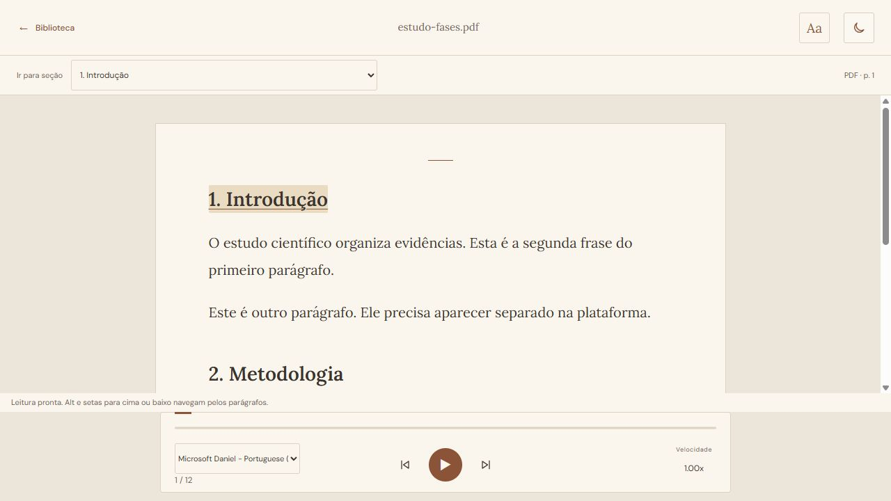
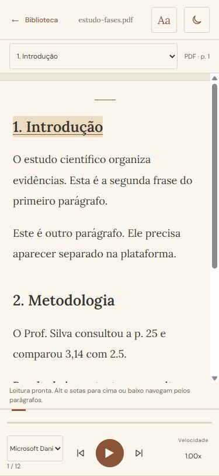

# Resultado das fases 1–3

Implementação local de 03/11/2026, seguindo a ordem da auditoria. Nenhuma dependência nova, commit ou publicação.

## 1. Integridade do material

- Números do corpo/tabelas deixam de ser removidos como paginação; anos no topo são preservados. Paginação é tratada por posição e evidência de contador/rótulo.
- Títulos próximos ao corpo e parágrafos com recuo conservam separações nos casos de regressão.
- Abreviações acadêmicas, iniciais, endereços completos, parâmetros de URL e DOI são protegidos da fragmentação indevida.
- Referências podem ficar visíveis e não narradas. Propaganda e lixo técnico continuam fora dos blocos de leitura.
- PDF sem texto selecionável recebe indicação de OCR; senha, tamanho e demais falhas mantêm mensagens específicas.

## 2. Documento estruturado no leitor

- Novo contrato `blocos_leitura`, posterior à filtragem, com tipo, hierarquia, origem e estilos.
- Títulos HTML, parágrafos, negrito e itálico preservados, mantendo a leitura contínua, destaque e IDs de frases.
- Sumário usa os títulos dos blocos, sem duplicar numeração; página de origem aparece no leitor.
- TXT mantém o texto visual original. Compatibilidade com API antiga usa apenas frases já filtradas, sem reintroduzir a estrutura bruta.

## 3. Motor de estudo

- Preparação de pronúncia separada do texto exibido.
- Retomada pela última fronteira de palavra recebida da voz; aviso visível quando a voz exige reiniciar a frase.
- Pausas curtas entre blocos, troca de velocidade/voz com preservação da posição disponível e invalidação de callbacks antigos.
- Reproduzir após o término recomeça a leitura.
- Posição por teclado com setas/Home/End e blocos com Alt + ↑/↓ na área do texto; estado do player exposto à acessibilidade.
- Upload cancelável, inclusive durante a identificação do arquivo, timeout de três minutos e erros específicos.
- Identidade SHA-256 calculada localmente; materiais diferentes com mesmo nome não compartilham posição. Âncoras usam hashes, sem guardar texto do livro.
- Confirmação conservadora para aproveitar progresso antigo baseado no nome; velocidade salva imediatamente; aviso quando o navegador não consegue persistir o progresso.
- Seleções concorrentes são invalidadas antes do upload, evitando associar texto à identidade de outro arquivo.

## O que deu certo na verificação

**90 testes Python + 32 testes JavaScript/navegador passaram**, sem casos ignorados no conjunto final de navegador. Houve integração com a API local real e PDF sintético, além das simulações determinísticas de voz.

A conferência visual confirmou três títulos, seis parágrafos, estilos e referência integral no PDF demonstrativo. Desktop claro/escuro e larguras de 320/375 px ficaram sem overflow horizontal, com o player fora do texto. O painel Aa e as regressões de 320 a 1440 px passaram nas suítes existentes.

A revisão independente encontrou dois casos adicionais — querystrings e concorrência de importações — reproduzidos e corrigidos com testes. O ambiente ainda emite um aviso de depreciação de TestClient/httpx; não houve falha associada.

**Limites:** isso não comprova a precisão de qualquer PDF acadêmico, a qualidade acústica, a taxa exata das vozes ou a leitura em celular físico/tela bloqueada. A extração continua heurística e não faz OCR. Tabelas complexas, matemática e layouts incomuns ainda precisam de validação representativa.

As mudanças estão no checkout local. Para chegarem ao site público, será necessário publicar frontend e backend posteriormente; publicar apenas o frontend preserva compatibilidade, mas não atualiza a extração do servidor.

## Próximas três fases para execução

**Fase 4 — fluidez com medições.** Medir importação, renderização, memória e troca de frase em materiais grandes. Depois reduzir varreduras do destaque, listeners por frase e duplicação de payload, mantendo seleção, filtros e rolagem contínua. Aprovar somente com comparação antes/depois e ausência de regressões.

**Fase 5 — polimento para estudar.** Priorizar continuar estudos e documentos recentes na biblioteca; melhorar nomes das vozes, rótulos, seleção direta de velocidade e sobreposição do botão de tema. Preservar a identidade editorial e o conforto de leitura.

**Fase 6 — validação acadêmica e acessibilidade real.** Comparar amostras autorizadas de apostilas, artigos, duas colunas, slides, tabelas e referências com os originais; testar vozes por escuta, celular físico, segundo plano/tela bloqueada, zoom e NVDA/TalkBack. Corrigir discrepâncias encontradas e documentar os limites antes de preparar a publicação.

Busca, anotações e marcadores continuam como oportunidades posteriores, sem ampliar silenciosamente o escopo dessas fases.

Plano e registro técnico: `docs/superpowers/plans/2026-11-03-tres-fases-estudo.md`.
